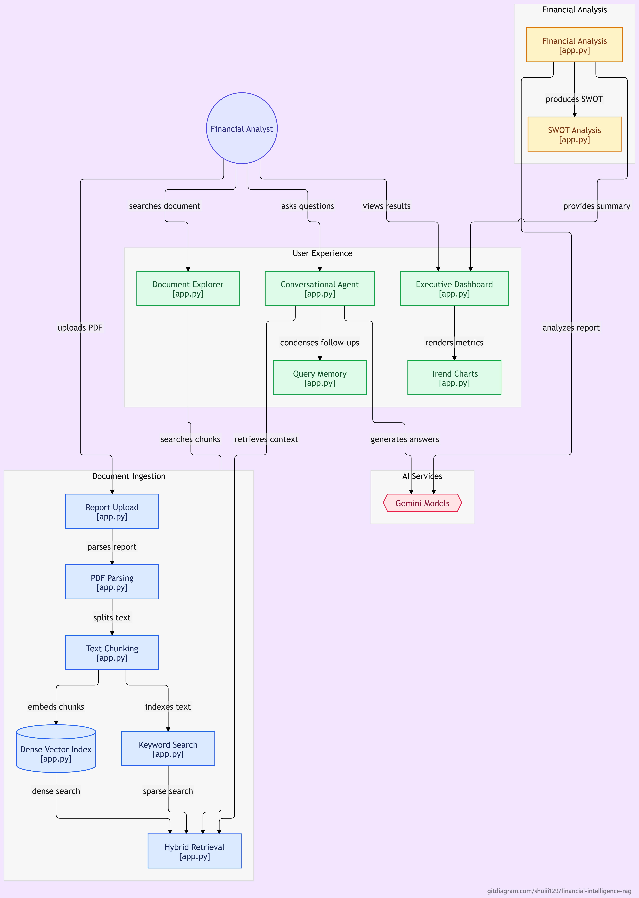

# 📈 Executive Financial RAG Platform

An enterprise-grade, context-aware Retrieval-Augmented Generation (RAG) platform tailored for executive financial analysis. The application ingests corporate filings (such as 10-K, 10-Q, annual reports, or investor presentations in PDF format), performs hybrid dense-sparse semantic retrieval, automatically synthesizes executive summaries, key financial metrics with YoY comparisons, and SWOT analyses, and offers a multilingual conversational assistant.

---

## 📑 Table of Contents

- [Overview](#-overview)
- [Key Features](#-key-features)
- [System Architecture](#-system-architecture)
- [Tech Stack & Dependencies](#-tech-stack--dependencies)
- [Prerequisites & Installation](#-prerequisites--installation)
- [Running the Application](#-running-the-application)
  - [Option A: Google Colab](#option-a-google-colab-recommended)
  - [Option B: Local Machine / Standalone Server](#option-b-local-machine--standalone-server)
- [Application Workflow & Technical Deep Dive](#-application-workflow--technical-deep-dive)
  - [1. PDF Ingestion & Recursive Chunking](#1-pdf-ingestion--recursive-chunking)
  - [2. Dual-Engine Hybrid Retrieval (FAISS + BM25)](#2-dual-engine-hybrid-retrieval-faiss--bm25)
  - [3. Financial Metrics & SWOT Extraction Pipeline](#3-financial-metrics--swot-extraction-pipeline)
  - [4. Multilingual Question-Answering & Memory](#4-multilingual-question-answering--memory)
  - [5. Model Selection & Automatic Fallback Engine](#5-model-selection--automatic-fallback-engine)
- [User Interface Guide](#-user-interface-guide)
  - [Sidebar Controls](#sidebar-controls)
  - [Tab 1: Executive Dashboard](#tab-1-executive-dashboard)
  - [Tab 2: Conversational Agent](#tab-2-conversational-agent)
  - [Tab 3: Document Inspector](#tab-3-document-inspector)
- [Troubleshooting & Best Practices](#-troubleshooting--best-practices)

---

## 🔭 Overview

Financial documents often span hundreds of pages with dense tables, regulatory disclosures, and narrative reporting. Traditional search tools and naive vector-only RAG systems frequently miss exact financial figures or lack contextual synthesis.

The **Executive Financial RAG Platform** bridges this gap by combining:
- **Lexical Keyword Precision (BM25)** with **Dense Semantic Understanding (FAISS)**.
- Automated structural extraction for high-level decision makers (YoY metric tracking, visual Plotly comparison charts, and SWOT breakdowns).
- A multilingual interactive chat interface that enforces strict document grounding and page citations.

---

## ✨ Key Features

1. **📊 Instant Executive Dashboard**:
   - **Automated Synthesis**: Generates a professional executive summary from initial report pages.
   - **Key Metric Extraction**: Detects Revenue, Net Income, Operating Income/EBITDA, Total Assets, and Total Liabilities, parsing currency and percentage changes.
   - **Interactive Plotly Visualizations**: Normalizes and plots prior vs. current period numbers in scaled millions.
   - **Structured SWOT Grid**: Four-quadrant glassmorphic cards highlighting Strengths, Weaknesses, Opportunities, and Threats.

2. **⚡ Hybrid Ensemble Retrieval (FAISS + BM25)**:
   - Combines vector embeddings (`GoogleGenerativeAIEmbeddings`) with term frequency-based BM25 scoring at equal 50/50 weighting.
   - Overcomes vector blindness on exact accounting terminology, tickers, and numeric tables.

3. **💬 Multilingual Conversational Agent**:
   - Seamlessly interacts in **English, Bahasa Melayu, and Mandarin (中文)**.
   - Automatically detects user language and responds in the same language.
   - Implements conversational query condensation to resolve multi-turn references.
   - Enforces strict zero-hallucination grounding with explicit **Page Citations** (`[Page X]`).
   - Collapsible hybrid chunk inspector to verify retrieval transparency.

4. **🔍 Document Inspector & Keyword Search**:
   - Real-time indexing telemetry (total pages, chunk count, chunk size).
   - Direct document search query interface to review raw matching text passages.

5. **🛡️ Resilient Model Fallback Architecture**:
   - Primary support for `gemini-3.8-flash`, `gemini-3.5-flash-lite`, `gemini-3.1-pro-preview`, and `gemini-2.5-flash`.
   - Automatic graceful fallback to `gemini-3.5-flash-lite` if advanced models hit quotas or rate limits.
   - Built-in embedding rate-limiting (0.75s throttle) to respect Gemini free-tier QPM limits.

---

## 🏗 System Architecture



```text
┌────────────────────────────────────────────────────────┐
│                   Uploaded PDF Report                  │
└───────────────────────────┬────────────────────────────┘
                            │
               ┌────────────▼────────────┐
               │    PyPDFLoader Ingest   │
               └────────────┬────────────┘
                            │
       ┌────────────────────▼────────────────────┐
       │   RecursiveCharacterTextSplitter        │
       │   (Chunk Size: 3000, Overlap: 400)      │
       └──────────────┬──────────────────┬───────┘
                      │                  │
         ┌────────────▼────────┐   ┌─────▼──────────────┐
         │ Google GenAI Embeds │   │ BM25 Lexical Token │
         │   (FAISS Index)     │   │     (BM25Retriever)│
         └────────────┬────────┘   └─────┬──────────────┘
                      │                  │
                      └────────┬─────────┘
                               │
                ┌──────────────▼──────────────┐
                │   EnsembleRetriever (50/50) │
                └──────────────┬──────────────┘
                               │
        ┌──────────────────────┼──────────────────────┐
        │                      │                      │
 ┌──────▼─────────────┐ ┌──────▼──────────────┐ ┌─────▼──────────────┐
 │ Executive Extractor│ │ Condense & Chat QA  │ │ Direct Document    │
 │ (Gemini JSON Mode) │ │ (Multilingual LLM)  │ │ Inspector Explorer │
 └──────┬─────────────┘ └──────┬──────────────┘ └────────────────────┘
        │                      │
 ┌──────▼─────────────┐ ┌──────▼──────────────┐
 │ Dashboard, Plotly  │ │ Grounded Responses  │
 │ Cards & SWOT Grid  │ │ with Page Citations │
 └────────────────────┘ └─────────────────────┘
```

---

## 🧰 Tech Stack & Dependencies

- **Language**: Python 3.10+
- **Frontend / Application Framework**: [Streamlit](https://streamlit.io/)
- **LLM & Embeddings Orchestration**:
  - `langchain`, `langchain-core`, `langchain-community`, `langchain-classic`, `langchain-text-splitters`
  - `langchain-google-genai` (Google Gemini 3.8 / 3.5 / 2.5 series)
- **Vector & Lexical Search**:
  - `faiss-cpu` (Dense vector similarity)
  - `rank-bm25` (Sparse term frequency ranking)
- **PDF Processing**: `pypdf`
- **Data & Data Visualization**:
  - `pandas`
  - `plotly` (Interactive grouped bar charts)
- **Environment Management**: `python-dotenv`

---

## 📦 Prerequisites & Installation

### 1. Obtain a Google Gemini API Key
You will need a valid Google Gemini API Key. You can generate one at [Google AI Studio](https://aistudio.google.com/).

### 2. Environment Setup

Clone or place the repository files in your workspace, then install the dependencies:

```bash
pip install --upgrade \
    langchain \
    langchain-core \
    langchain-community \
    langchain-classic \
    langchain-google-genai \
    langchain-text-splitters \
    streamlit \
    plotly \
    python-dotenv \
    pypdf \
    faiss-cpu \
    rank-bm25
```

*(Optional)* Create a `.env` file in the root directory to store your API key:
```ini
GOOGLE_API_KEY=your_gemini_api_key_here
```

---

## 🚀 Running the Application

### Option A: Google Colab (Recommended)
The notebook script `financial_rag_colab_fixed.py` is configured for Google Colab environments:
1. Upload `financial_rag_colab_fixed.py` (or open it as an `.ipynb` in Google Colab).
2. Execute the first cell to install dependencies.
3. Restart the Colab session (**Runtime → Restart session**) to reload C-extensions.
4. Execute the verification and `%%writefile app.py` cells.
5. Launch the Streamlit server cell; Colab will render an embedded iframe and display a direct proxy link.

### Option B: Local Machine / Standalone Server
To run locally on your machine or cloud VM:

1. **Extract `app.py`**:
   Save the application portion of `financial_rag_colab_fixed.py` (everything under the `%%writefile app.py` block) as `app.py`.

2. **Launch Streamlit**:
   ```bash
   streamlit run app.py
   ```

3. **Access the Web Interface**:
   Open your browser and navigate to `http://localhost:8501`.

---

## 🔬 Application Workflow & Technical Deep Dive

### 1. PDF Ingestion & Recursive Chunking
When a user uploads a financial PDF:
- The file is written to a secure temporary file and processed via `PyPDFLoader`.
- It splits the document using `RecursiveCharacterTextSplitter`:
  - **`chunk_size`**: 3,000 characters
  - **`chunk_overlap`**: 400 characters
  - **Separators**: Paragraphs (`\n\n`), newlines (`\n`), periods (`.`), spaces (` `).
- Preserves page metadata (`page` index) on each chunk to enable auditability and citations.

### 2. Dual-Engine Hybrid Retrieval (FAISS + BM25)
Standard vector embeddings can struggle with financial filings where precise numbers, specific line items, or exact account codes appear. This platform integrates:
- **FAISS Vector Store**: Uses `GoogleGenerativeAIEmbeddings` (`gemini-embedding-2` with fallback to `gemini-embedding-001`). Captures semantic meaning, concepts, and phrasing.
- **BM25 Lexical Retriever**: Tokenizes the splits and builds an in-memory inverted index to match exact terms (e.g., "EBITDA", "Note 14", "Restricted Cash").
- **Ensemble Retriever**: Merges rankings using Reciprocal Rank Fusion / Weighted Scoring with:
  $$\text{Weight}_{\text{FAISS}} = 0.5, \quad \text{Weight}_{\text{BM25}} = 0.5$$

### 3. Financial Metrics & SWOT Extraction Pipeline
Upon initial indexing:
- The first 20 chunks (plus the last 5 chunks if the document exceeds 25 pages) are extracted to cover the Executive Letter, Management Discussion & Analysis (MD&A), and Summary Financial Statements.
- A zero-temperature Gemini prompt prompts the model to return structured JSON:
  - **Executive Summary**: 3–4 sentence overview.
  - **Key Metrics**: Revenue, Net Income, Operating Income/EBITDA, Total Assets, Total Liabilities.
  - **SWOT Analysis**: Bullet points categorized into Strengths, Weaknesses, Opportunities, and Threats.
- A custom `robust_json_parser` handles markdown fence stripping, trailing commas, and malformed syntax recovery.
- A metric parsing engine (`parse_num`) extracts numeric figures and units (Billion, Million, Thousand) for Plotly visualization.

### 4. Multilingual Question-Answering & Memory
- **Question Condensation**:
  Prior conversation turns are summarized with the latest user question via `condense_question` to resolve ambiguous pronouns (e.g., "What about in the prior year?").
- **Multilingual Support**:
  The system prompt detects whether the query is in English, Malay, or Mandarin, and ensures the response is formulated in that exact language.
- **Source Verification & Grounding**:
  The model is constrained strictly to the retrieved context chunks. If the answer is not present, it explicitly replies that the document does not contain the answer. Every answer concludes with page number references (`[Page X]`).

### 5. Model Selection & Automatic Fallback Engine
- Users can choose from:
  - `gemini-3.8-flash` (Fast, highly capable default)
  - `gemini-3.5-flash-lite` (Lightweight fallback model)
  - `gemini-3.1-pro-preview` (Deep reasoning model)
  - `gemini-2.5-flash` (Stable generation)
- If a quota or API limit occurs on higher-tier models, the application catches the exception and falls back to `gemini-3.5-flash-lite`.

---

## 🖥 User Interface Guide

### Sidebar Controls
- **Google API Key**: Input field with masked password input for secure session handling.
- **Model Settings**: Dropdown selector to switch LLM backends dynamically.
- **File Uploader**: Accepts PDF documents up to standard Streamlit file limits.
- **Document Status & Index Metadata**: Displays active search mode, total indexed pages, total generated chunks, and base chunk size.
- **Clear Chat Memory**: One-click reset for the conversational history.

### Tab 1: Executive Dashboard
- **Executive Summary Card**: Highlighted visual banner summarizing company performance.
- **Metric Cards**: Dynamic KPI tiles displaying current figures, prior period comparisons, and YoY percentage change indicators (green for growth, red for decline).
- **Plotly Visual Comparison Chart**: Grouped bar chart comparing key metrics across periods.
- **SWOT Grid**: 4-quadrant layout with color-coded borders (Green for Strengths, Red for Weaknesses, Blue for Opportunities, Yellow for Threats).

### Tab 2: Conversational Agent
- Chat message feed supporting user and assistant avatars.
- Multilingual chat input field.
- **Expandable Chunk Inspector**: Toggle "🔍 View Retrieved Hybrid Chunks" below any response to inspect the exact textual evidence and source pages passed to Gemini.

### Tab 3: Document Inspector
- Summary metrics of the active document index.
- **Direct Document Explorer**: Keyword query input to search through the document and inspect raw matching passages with page tags.

---

## 🛠 Troubleshooting & Best Practices

| Issue | Cause | Solution |
| :--- | :--- | :--- |
| **"The uploaded PDF contains no readable pages"** | PDF is an image scan without an embedded text layer. | Run the PDF through an OCR tool (e.g. Adobe Acrobat OCR or Tesseract) prior to upload. |
| **Financial metrics show "N/A"** | Uploaded document lacks consolidated financial tables (e.g., DEF 14A proxy statements). | Upload annual reports (10-K), quarterly reports (10-Q), or financial press releases containing consolidated balance sheets and income statements. |
| **Google Generative AI ResourceExhausted (429)** | Exceeded Gemini free-tier QPS/QPM limits. | The app includes a 0.75s embedding delay. If quota is exceeded, wait 60 seconds, switch to `gemini-3.5-flash-lite`, or use a paid tier API key. |
| **All configured Gemini embedding models failed** | Invalid API key or model availability region. | Verify that your API key is active on Google AI Studio and has permissions for embedding generation. |
| **Streamlit WebSocket / Port Issues on Colab** | Colab proxy headers blocking WebSocket traffic. | The script starts Streamlit with `--server.enableCORS false --server.enableXsrfProtection false`. Use the generated proxy link. |

---

## 📄 License & Attribution

Built with Google Gemini, Streamlit, and LangChain. Designed for executive financial analysis and corporate filing inspection.
